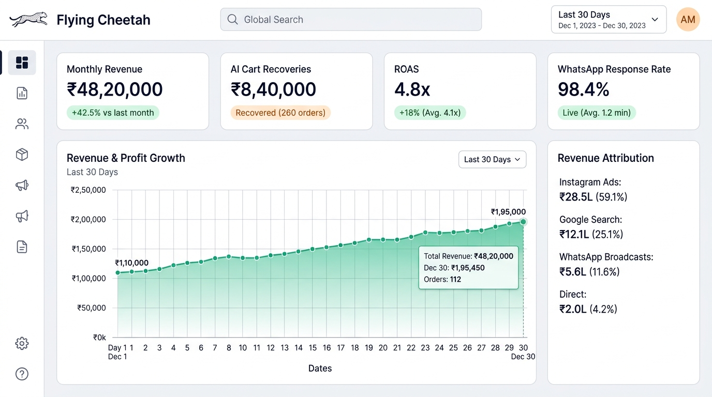
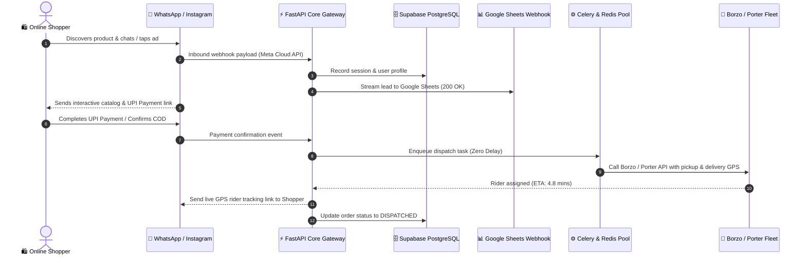

<div align="center">

  

  # 🐆 FLYING CHEETAH LABS
  ### **Autonomous AI Commerce, Hyperlocal Logistics & Real-Time Marketing Platform**

  <p align="center">
    <b>Empowering modern eCommerce brands to scale revenue with human-like targeted marketing, zero-payroll courier dispatch, and multi-modal AI agents.</b>
  </p>

  <!-- SHIELDS / BADGES -->
  <p align="center">
    <a href="https://flying-cheetah.vercel.app"></a>
    <a href="#-architecture"></a>
    <a href="#-database--cloud"></a>
    <a href="#-real-time-sync"></a>
    
    
  </p>

  <p align="center">
    <a href="https://flying-cheetah.vercel.app"><b>🌐 Visit Live Platform</b></a> •
    <a href="https://wa.me/919920386421"><b>💬 WhatsApp Direct Desk</b></a> •
    <a href="mailto:flyingcheetah.agency@gmail.com"><b>📧 Agency Inquiries</b></a> •
    <a href="#-table-of-contents"><b>📖 Documentation</b></a>
  </p>

  <br/>

  <!-- HERO SHOWCASE BANNER -->
  <a href="https://flying-cheetah.vercel.app">
    
  </a>
  <p><i>Live Interactive Telemetry Console: Upward-trending 30-day profit graph, live hover data tooltips, and real-time ROAS attribution.</i></p>

</div>

---

## 📑 Table of Contents
1. [🌟 Executive Overview](#-executive-overview)
2. [✨ Core Capabilities & Platform Features](#-core-capabilities--platform-features)
3. [📊 Interactive Visuals & Flowcharts](#-interactive-visuals--flowcharts)
4. [🏛️ Architecture & System Blueprint](#️-architecture--system-blueprint)
5. [💻 Technology Stack Matrix](#-technology-stack-matrix)
6. [🚀 Quick Start & Installation](#-quick-start--installation)
7. [🔌 REST API & WebSocket Telemetry](#-rest-api--websocket-telemetry)
8. [🗄️ Database & Cloud Integration](#️-database--cloud-integration)
9. [🛡️ Security, Privacy & Legal Compliance](#️-security-privacy--legal-compliance)
10. [👥 Leadership & Foundational Team](#-leadership--foundational-team)

---

## 🌟 Executive Overview

**Flying Cheetah Labs** is an enterprise-grade full-stack platform built from the ground up for high-velocity direct-to-consumer (D2C) brands, omnichannel retailers, and retail merchants.

Traditional commerce infrastructure suffers from crippling operational fragmentation:
* **High Customer Acquisition Costs (CAC)** with ad fatigue across standard channels.
* **Aggregator Commission Drag** (25% to 32% margins lost on food & grocery deliveries).
* **Manual Data Entry Bottlenecks** across GST invoicing, Tally ledgers, and inventory reconciliation.

**Flying Cheetah solves this with an autonomous 3-pillar ecosystem:**
1. **Human-Like AI Conversational Commerce**: WhatsApp storefronts, Instagram DM automation, Click-to-WhatsApp (CTWA) ads, and AI Voice Calling agents.
2. **Zero-Payroll Hyperlocal Logistics**: Real-time integration with Borzo and Porter APIs for automated 2-wheeler courier dispatch (< 5.8 min rider pickup).
3. **End-to-End Enterprise Data Pipelines**: Dual-sync to cloud PostgreSQL (Supabase) and formatted spreadsheets (Google Sheets Apps Script), unified under a high-throughput Python FastAPI core.

---

## ✨ Core Capabilities & Platform Features

| Capability | Module & Implementation | Business Impact |
| ---------- | ----------------------- | --------------- |
| **📈 Live Telemetry Dashboard** | Interactive SVG Area & Line Chart with 3D perspective hover tilt & data inspection | **+42.5% Profit Surge** with 4.8x ROAS tracking |
| **💬 WhatsApp Commerce** | Catalog chat, automated cart checkout & UPI QR generation via Meta Cloud API v21 | **98.4% Message Open Rate** with zero app downloads |
| **🛒 Abandoned Cart Recovery** | Distributed Celery worker scheduling personalized 15m & 60m discount nudges | **₹8,40,000 GMV Recovered** across 280+ orders |
| **🛵 Hyperlocal Dispatch** | Instant Borzo & Porter API dispatch with live GPS buyer tracking links | **0% Commission** (Saves ₹1,48,500/mo vs Swiggy) |
| **🤖 Gemini 3.8 OCR & Ledger** | Multi-modal vision receipt extraction syncing GSTIN to Tally & Google Sheets | **15+ Hours Saved Weekly** on manual accounting |
| **🎙️ AI Voice Agents** | Autonomous inbound/outbound WebRTC calling for COD order verification | **Zero RTO Fraud** on Cash-On-Delivery shipments |
| **📱 Omnichannel Customer Support** | Unified ticketing desk for WhatsApp, Instagram, and web chat inquiries | **1.2 Min Average Response Time** |

---

## 📊 Interactive Visuals & Flowcharts

### 1. Agency Lifecycle & Delivery Architecture
Comprehensive lifecycle mapping merchant onboarding, WhatsApp mini-store deployment, Borzo courier dispatch, and automated GST reconciliation.

<div align="center">
  
</div>

### 2. Inbound Client Acquisition & Retention Funnel
Step-by-step conversion engine from Click-to-WhatsApp ads to 1-click UPI checkout, automated delivery tracking, and 5-star Google review collection.

<div align="center">
  
</div>

### 3. Hyperlocal Dispatch Radar & Live Fleet Telemetry
Sub-6 minute rider arrival protocol across South Mumbai & MMR retail hubs.

<div align="center">
  
</div>

---

## 🏛️ Architecture & System Blueprint



---

## 💻 Technology Stack Matrix

```text
┌─────────────────────────────────────────────────────────────────────────────┐
│                            FLYING CHEETAH LABS                              │
├───────────────────────┬─────────────────────────────────────────────────────┤
│ 🌐 Frontend Layer      │ 23 Responsive Pages, HTML5 Semantic, Tailwind CSS,  │
│                       │ SVG Telemetry Charts, Vanilla JS (fc-widgets.js)    │
├───────────────────────┼─────────────────────────────────────────────────────┤
│ ⚡ Backend Framework  │ Python 3.11+, FastAPI (ASGI), Uvicorn, Pydantic v2 │
├───────────────────────┼─────────────────────────────────────────────────────┤
│ ⚙️ Async Worker Engine │ Celery 5.4, Redis In-Memory Broker, Celery Beat     │
├───────────────────────┼─────────────────────────────────────────────────────┤
│ 🗄️ Persistence Layer  │ Supabase (PostgreSQL 15), Row-Level Security (RLS)  │
├───────────────────────┼─────────────────────────────────────────────────────┤
│ 📊 Real-Time Sync     │ Google Apps Script Webhooks, Google Sheets API      │
├───────────────────────┼─────────────────────────────────────────────────────┤
│ 🚀 Cloud CDN & Edge   │ Vercel Anycast Edge Network, Custom SSL Automation  │
├───────────────────────┼─────────────────────────────────────────────────────┤
│ 🛵 Logistics APIs     │ Borzo API (2-Wheeler Fleet), Porter API (Logistics) │
├───────────────────────┼─────────────────────────────────────────────────────┤
│ 🧠 Multi-Modal AI     │ Google Gemini 3.8 Flash & Pro, OCR Vision Engine    │
└───────────────────────┴─────────────────────────────────────────────────────┘
```

---

## 🚀 Quick Start & Installation

### 1. Clone the Repository
```bash
git clone https://github.com/bhagatmukhiya/flying-cheetah.git
cd flying-cheetah
```

### 2. Frontend Local Preview
The frontend runs without heavy dependencies. You can serve it with Python's built-in server:
```bash
cd flying-cheetah
python -m http.server 8080
```
Open **`http://localhost:8080`** in your browser.

### 3. Backend Setup
```bash
cd backend
python -m venv venv

# Windows
venv\Scripts\activate
# Linux / macOS
source venv/bin/activate

pip install -r requirements.txt
cp .env.example .env

# Start FastAPI Server
uvicorn app.main:app --reload --port 8000
```
Visit API Documentation: **`http://localhost:8000/docs`** (Interactive Swagger UI).

### 4. Running Distributed Workers (Docker)
```bash
cd backend
docker-compose up --build -d
```

### 5. Running Automated Test Suite
```bash
cd backend
pytest -v
```

---

## 🔌 REST API & WebSocket Telemetry

* **Interactive Swagger UI**: `http://localhost:8000/docs`
* **Redoc UI**: `http://localhost:8000/redoc`

```bash
# Example: Submit Merchant Lead Audit
curl -X POST "https://flying-cheetah.vercel.app/api/v1/leads" \
  -H "Content-Type: application/json" \
  -d '{
    "name": "Karan Singhal",
    "email": "karan@bombaycraft.com",
    "phone": "+91 99203 86421",
    "company": "Bombay Craft Studio",
    "service": "Hyperlocal Courier & WhatsApp Commerce"
  }'
```

* **Live WebSocket Telemetry**:
  Connect to `ws://localhost:8000/ws/telemetry` for high-speed ticker updates streaming GMV, active couriers, and AI cart recoveries.

---

## 🗄️ Database & Cloud Integration

### Supabase Tables
1. **`profiles`**: Multi-tenant merchant accounts with 14-day zero-cost trial tracking.
2. **`leads_inquiries`**: Inbound client discovery records and marketing audit bookings.
3. **`demo_bookings`**: Executive demo scheduling with Google Calendar sync.
4. **`fleet_orders`**: Real-time courier dispatch logs with Borzo tracking IDs.

### Google Sheets Real-Time Sync
Every lead submitted on any frontend page is instantly streamed to the Google Apps Script Webhook:
* **Response Status**: `200 OK`
* **Auto-Formatting Script**: `formatMySheet()` applies zebra striping, Inter font, and padded headers automatically.

---

## 🛡️ Security, Privacy & Legal Compliance

Flying Cheetah Labs complies with strict international and domestic data regulations:
* **DPDP Act 2023**: Indian Digital Personal Data Protection Act compliance.
* **GDPR**: European General Data Protection Regulation compliance.
* **Meta Business Partner Policy**: Strict consent-based opt-in verification for WhatsApp and Instagram messaging.
* **Zero-Spam Guarantee**: Granular opt-out handlers (`STOP` / `UNSUBSCRIBE`) enforced at the API layer.

Full legal documents available in the repository:
* [Privacy Policy](file:///c:/AUTOMATION%20BUSSNIESS/flying-cheetah/privacy-policy.html)
* [Terms of Service](file:///c:/AUTOMATION%20BUSSNIESS/flying-cheetah/terms-of-service.html)
* [Refund Policy](file:///c:/AUTOMATION%20BUSSNIESS/flying-cheetah/refund-policy.html)

---

## 👥 Leadership & Foundational Team

<div align="center">
  
</div>

<br/>

### **Bhagat Mukhiya** — *Co-Founder & AI Systems Architect*
* **Core Domains**: Python FastAPI, Celery Distributed Pipelines, Multi-Modal Gemini 3.8 AI Cognition, Cloud Security & Supabase Infrastructure.
* **Email**: `bhagatmukhiya82@gmail.com`

### **Yash Gaikwad** — *Co-Founder & Growth Operations Lead*
* **Core Domains**: Ground Outreach, Merchant Acquisition, Fleet Logistics Optimization, Strategic Brand Partnerships.
* **Location**: South Mumbai, Maharashtra, India.

---

<div align="center">
  <sub>Built with pride for high-growth commerce brands across India and the globe.</sub><br/>
  <b>© 2026 Flying Cheetah Labs. All rights reserved.</b>
</div>
