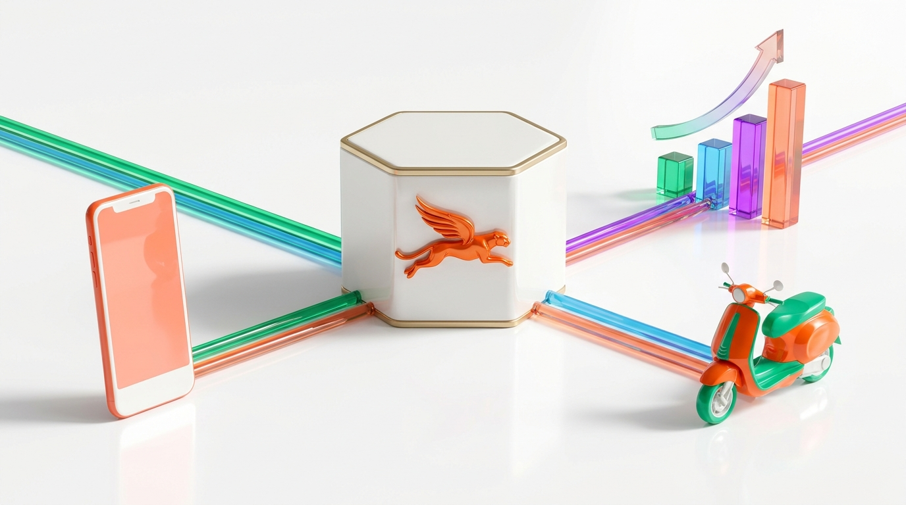
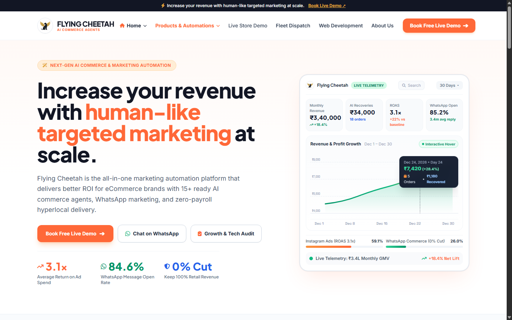
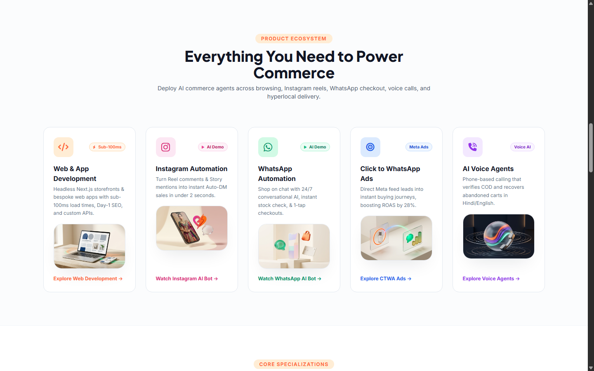
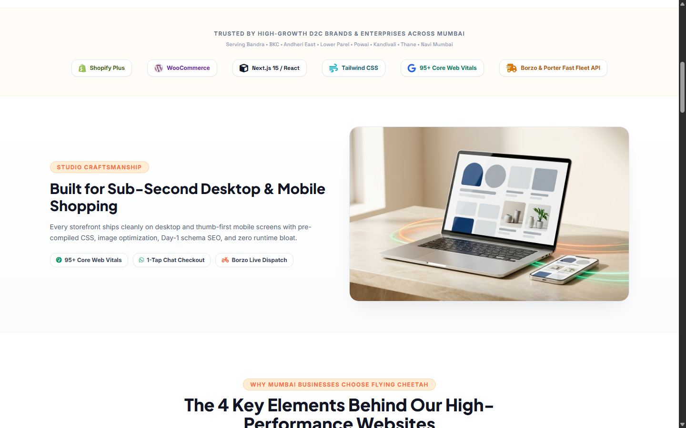
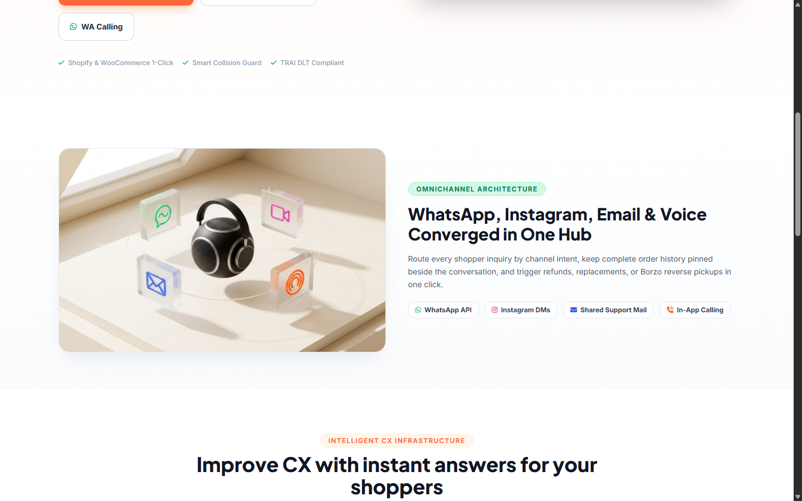
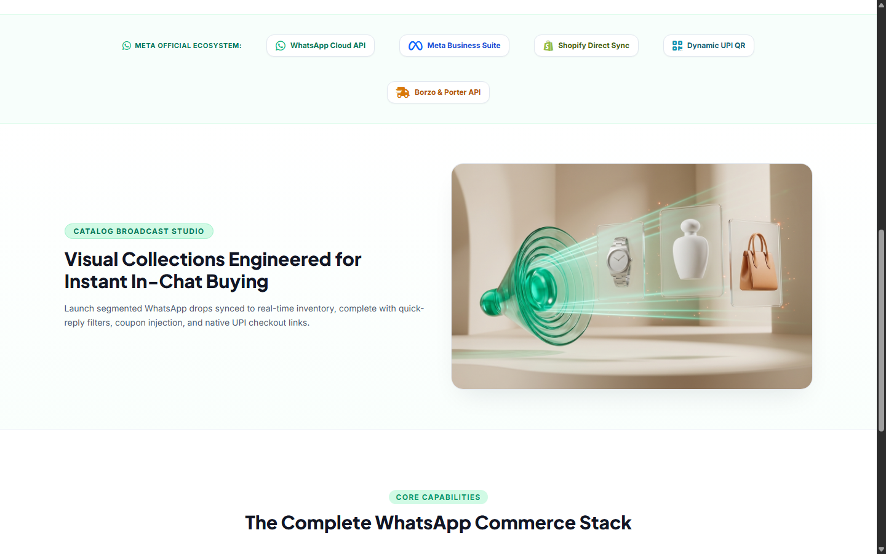
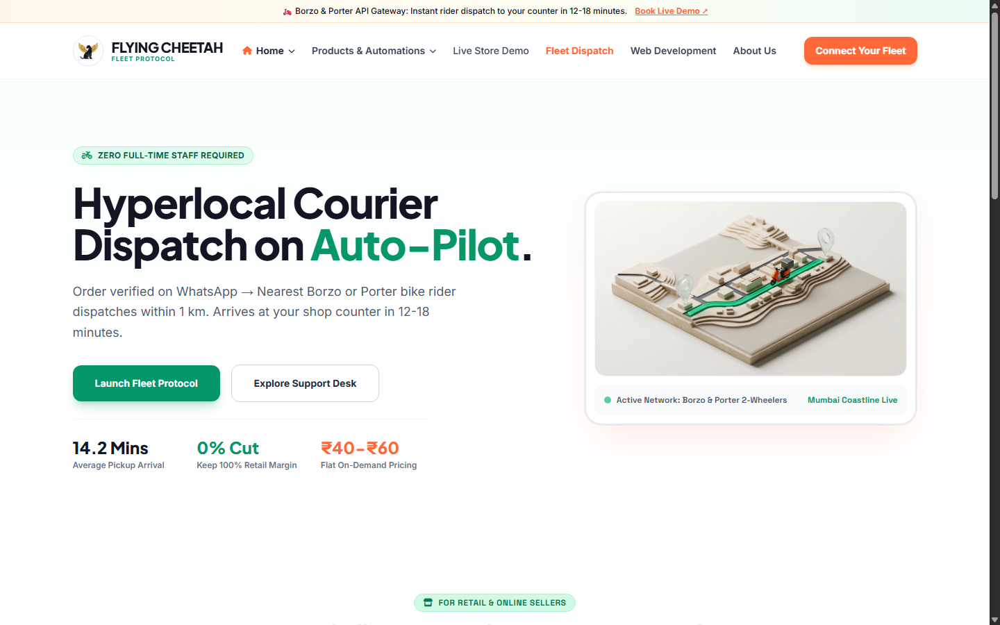
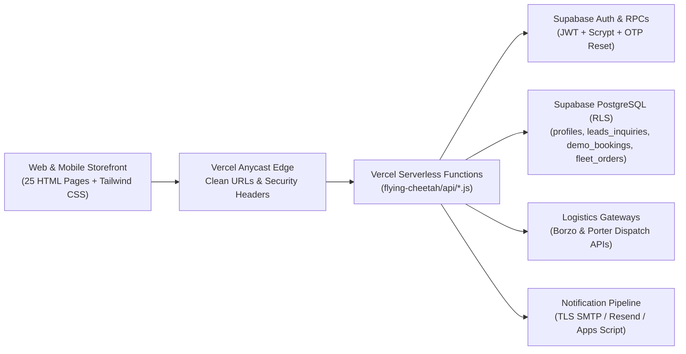

<div align="center">

  <a href="https://flying-cheetah.vercel.app">
    
  </a>

  <h1>FLYING CHEETAH LABS</h1>
  <p><strong>AI Marketing Automation, High-Speed Storefronts &amp; Hyperlocal Commerce Platform</strong></p>

  <p>
    <a href="https://flying-cheetah.vercel.app"></a>
    <a href="#system-architecture"></a>
    <a href="#database--auth"></a>
    <a href="#local-development--testing"></a>
    <a href="LICENSE"></a>
  </p>

  <p>
    <a href="https://flying-cheetah.vercel.app"><strong>Live Platform</strong></a> &bull;
    <a href="https://flying-cheetah.vercel.app/demo"><strong>Book 1-on-1 Demo</strong></a> &bull;
    <a href="https://wa.me/919920386421"><strong>WhatsApp Desk</strong></a> &bull;
    <a href="mailto:flyingcheetah.agency@gmail.com"><strong>Agency Email</strong></a>
  </p>

  <br />

  <a href="https://flying-cheetah.vercel.app">
    
  </a>
  <p><em>Unified AI commerce workflows, sub-second headless storefronts, and zero-payroll Mumbai hyperlocal dispatch.</em></p>

</div>

---

## Table of Contents

1. [Executive Overview](#executive-overview)
2. [Live Platform Showcase](#live-platform-showcase)
3. [Core Capabilities](#core-capabilities)
4. [System Architecture](#system-architecture)
5. [Serverless API & Routes](#serverless-api--routes)
6. [Database & Auth](#database--auth)
7. [Repository Structure](#repository-structure)
8. [Local Development & Testing](#local-development--testing)
9. [Founders & Leadership](#founders--leadership)

---

## Executive Overview

**Flying Cheetah Labs** is an end-to-end eCommerce engineering and automation platform built for direct-to-consumer (D2C) retail brands across Mumbai MMR and India.

It brings together three core pillars under one unified architecture:

- **Conversational Commerce & Retention:** WhatsApp Cloud storefronts, Instagram Reel-to-DM automation, Click-to-WhatsApp (CTWA) funnels, AI Voice Calling agents, RCS rich carousels, DLT-compliant SMS failover, and automated email journeys.
- **High-Speed Web Engineering:** Clean, pre-compiled Tailwind CSS storefronts (`25` dedicated HTML pages including landing flows, interactive modules, storefront demo, and admin console) with Core Web Vitals focus.
- **Hyperlocal Logistics & Telemetry:** Zero-commission Borzo/Porter dispatch workflows, real-time analytics telemetry, and instant lead streaming to Supabase PostgreSQL, Google Sheets, and transactional mailers.

---

## Live Platform Showcase

> Captures below are rendered directly from the live `flying-cheetah/` build.

### 1. Flagship Hero & Interactive Telemetry Console
Single-line responsive chrome, conversion-focused hero copy, and an interactive hover SVG profit telemetry widget (`3.1x` ROAS, `84.6%` WhatsApp open rate, `0%` commission model).

<div align="center">
  <a href="https://flying-cheetah.vercel.app">
    
  </a>
</div>

### 2. Core Product Ecosystem
Cohesive bespoke studio product showcases across Web & App Development, Instagram Auto-DM, WhatsApp Commerce, Click-to-WhatsApp Ads, and AI Voice Calling.

<div align="center">
  <a href="https://flying-cheetah.vercel.app">
    
  </a>
</div>

### 3. Web Engineering & Omnichannel Support Workbench

<div align="center">
  <table>
    <tr>
      <td width="50%" align="center">
        <a href="https://flying-cheetah.vercel.app/web-development">
          
        </a>
        <br /><sub><strong>Web Engineering Showcase</strong> — <code>web-development.html</code></sub>
      </td>
      <td width="50%" align="center">
        <a href="https://flying-cheetah.vercel.app/customer-support">
          
        </a>
        <br /><sub><strong>Omnichannel Support Desk</strong> — <code>customer-support.html</code></sub>
      </td>
    </tr>
  </table>
</div>

### 4. WhatsApp Commerce & Hyperlocal Fleet Protocol

<div align="center">
  <table>
    <tr>
      <td width="50%" align="center">
        <a href="https://flying-cheetah.vercel.app/whatsapp-marketing">
          
        </a>
        <br /><sub><strong>WhatsApp Broadcast Studio</strong> — <code>whatsapp-marketing.html</code></sub>
      </td>
      <td width="50%" align="center">
        <a href="https://flying-cheetah.vercel.app/delivery">
          
        </a>
        <br /><sub><strong>Hyperlocal Fleet Protocol</strong> — <code>delivery.html</code></sub>
      </td>
    </tr>
  </table>
</div>

---

## Core Capabilities

| Capability | Primary Pages | Key Features |
| :--- | :--- | :--- |
| **Web & Storefront Engineering** | [`web-development.html`](flying-cheetah/web-development.html) | Pre-compiled Tailwind CSS, 95+ Vitals targeting, SEO JSON-LD schema, sub-second routing |
| **WhatsApp Commerce & Marketing** | [`whatsapp-automation.html`](flying-cheetah/whatsapp-automation.html), [`whatsapp-marketing.html`](flying-cheetah/whatsapp-marketing.html), [`store.html`](flying-cheetah/store.html) | Conversational catalog flows, interactive cart recovery, UPI checkout simulation |
| **Instagram & CTWA Acquisition** | [`instagram-automation.html`](flying-cheetah/instagram-automation.html), [`ctwa-automation.html`](flying-cheetah/ctwa-automation.html) | Automated Reel comment-to-DM workflows & Meta ad funnel routing |
| **AI Voice & Calling Helpdesk** | [`ai-voice-agents.html`](flying-cheetah/ai-voice-agents.html), [`whatsapp-calling.html`](flying-cheetah/whatsapp-calling.html), [`customer-support.html`](flying-cheetah/customer-support.html) | COD confirmation calling, acoustic telemetry UI, unified multi-channel inbox |
| **Omnichannel CDP, RCS, SMS & Email** | [`customer-data-platform.html`](flying-cheetah/customer-data-platform.html), [`rcs-messaging.html`](flying-cheetah/rcs-messaging.html), [`sms-marketing.html`](flying-cheetah/sms-marketing.html), [`email-marketing.html`](flying-cheetah/email-marketing.html) | 360-degree shopper profiles, verified rich Android carousels, DLT failover routes |
| **Hyperlocal Logistics & Admin CRM** | [`delivery.html`](flying-cheetah/delivery.html), [`demo.html`](flying-cheetah/demo.html), [`admin.html`](flying-cheetah/admin.html) | Borzo/Porter dispatch APIs, VIP walkthrough scheduler, JWT-protected admin dashboard |

---

## System Architecture



---

## Serverless API & Routes

Production rewrites in [`flying-cheetah/vercel.json`](flying-cheetah/vercel.json) expose clean REST endpoints under both `/api/*` and `/api/v1/*`:

| Endpoint | Methods | Purpose |
| :--- | :--- | :--- |
| `/api/health` | `GET` | Service readiness, cluster region (`mumbai-central-1`), and uptime telemetry |
| `/api/auth` | `GET`, `POST`, `PATCH` | Trial signup, password login, `me`, OTP forgot/reset flow, profile updates, and `403` guard on unverified OAuth payloads |
| `/api/leads` | `GET`, `POST`, `PATCH`, `DELETE` | Public lead capture with honeypot spam filtering + JWT-authenticated (`401` guarded) admin CRM read/update |
| `/api/demos` | `GET`, `POST` | 1-on-1 architecture demo scheduling and authenticated admin retrieval |
| `/api/telemetry` | `GET` | Real-time agency benchmark counters with database-backed fallback |
| `/api/fleet` | `GET` | Live hyperlocal courier telemetry stream for `delivery.html` |
| `/api/borzo-dispatch` | `POST` | Hyperlocal delivery dispatch handler (sandbox mode when `BORZO_AUTH_TOKEN` is unset) |
| `/api/send-email` | `POST` | Sanitized TLS SMTP (`_mailer.js`) / Resend email notifications and OTP dispatch |

> **Optional Legacy/Extended Python Service:** The root [`backend/`](backend/) directory also contains an optional standalone Python FastAPI service (`Dockerfile`, `docker-compose.yml`, `pytest` suite) for extended worker experiments, while production (`flying-cheetah.vercel.app`) runs directly on Vercel Serverless Functions + Supabase.

---

## Database & Auth

Backed by **Supabase (PostgreSQL + GoTrue Auth + Row-Level Security)**:

- **Tables:** `profiles`, `leads_inquiries`, `demo_bookings`, `fleet_orders`, `password_reset_otps`
- **Serverless Cold-Start Resilience:** OTP password resets and changes invoke `fc_store_password_otp` and `fc_verify_and_update_password` RPCs alongside `auth.users`, keeping resets consistent across serverless cold starts.
- **Security Headers & Secrets Hygiene:** Strict `X-Content-Type-Options`, `X-Frame-Options`, `X-XSS-Protection`, and `Referrer-Policy` headers enforced in [`vercel.json`](flying-cheetah/vercel.json); all API secrets live strictly in Vercel environment variables ([`.env.example`](flying-cheetah/.env.example)).

---

## Repository Structure

```text
.
├── flying-cheetah/                 # Production web application (Vercel root)
│   ├── *.html                      # 25 semantic HTML pages (index, service pages, store, demo, admin, 404)
│   ├── api/                        # Vercel Serverless Node handlers + shared auth/mailer helpers
│   ├── css/                        # input.css, fx.css, mobile-app.css, compiled styles.min.css
│   ├── js/                         # auth modules, leads capture, Supabase client, mobile UI widgets
│   ├── images/                     # Bespoke 3D studio renders, founder photos, logos & product photography
│   ├── videos/                     # Hero commercial & chatbot showcase MP4s
│   ├── tests/                      # Security, boundary, E2E, viewport & branding audit suites
│   ├── package.json                # Tailwind build & Node --test runner
│   └── vercel.json                 # Clean URLs, headers & API rewrites
├── docs/assets/                    # GitHub README studio banner & live screenshots
├── backend/                        # Optional FastAPI + Docker experimental service
├── README.md                       # Repository documentation
└── LICENSE                         # MIT License
```

---

## Local Development & Testing

```bash
# 1. Clone the repository
git clone https://github.com/bhagatmukhiya82-source/Flying-cheetah.git
cd Flying-cheetah/flying-cheetah

# 2. Install dev dependencies (Tailwind CSS CLI) & compile stylesheet
npm install
npm run build

# 3. Preview locally in your browser
npx http-server -p 8080
```

### Automated Test Suites

Run from inside `flying-cheetah/`:

```bash
# Core security, adversarial challenger & Tier 3/4 E2E scenarios
npm test

# Feature & boundary E2E test suites
node --test tests/e2e/tier1_feature.test.js tests/e2e/tier2_boundary.test.js

# 404, founder branding & empirical security audits
node tests/challenger1_404_test.js
node tests/challenger1_founder_branding_test.js
node tests/challenger1_empirical_audit.js
```

---

## Founders & Leadership

| Founder | Role & Focus | Connect |
| :--- | :--- | :--- |
| **Bhagat Mukhiya** | **Co-Founder & Technical Architect** — Serverless backend engineering, Supabase security/RLS, performance storefronts, and AI workflows | [](https://www.linkedin.com/in/bhagat-mukhiya-b74683380) [](https://github.com/bhagatmukhiya82-source) [](mailto:bhagatmukhiya82@gmail.com) |
| **Yash Gaikwad** | **Co-Founder & Growth Operations** — D2C client acquisition, Meta & WhatsApp campaign operations, and hyperlocal logistics partnerships | [](https://www.linkedin.com/in/yash-gaikwad-1669b0397) [](https://wa.me/919920386421) [](mailto:flyingcheetah.agency@gmail.com) |

---

<div align="center">
  <sub>Engineered in Mumbai &bull; Live at <a href="https://flying-cheetah.vercel.app">flying-cheetah.vercel.app</a></sub><br />
  <strong>&copy; 2026 Flying Cheetah Labs. Released under the MIT License.</strong>
</div>
