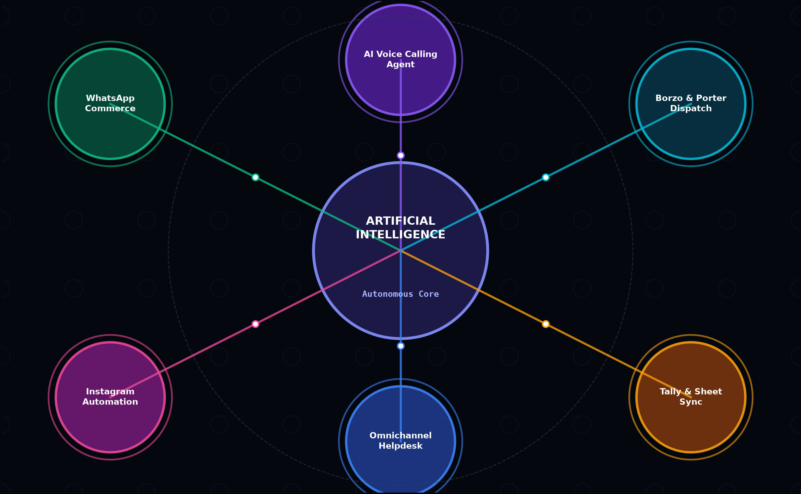

# 🏛️ System Architecture Specification

Flying Cheetah Labs is architected as an **enterprise-grade, event-driven autonomous AI commerce & marketing engine**. It unifies frontend storefronts, multi-channel messaging (WhatsApp, Instagram, RCS, SMS), AI voice agents, zero-payroll hyperlocal courier dispatch, and automated financial ledger sync.

---

## 📐 High-Level Architecture Diagram

<div align="center">
  
</div>

<br/>

```mermaid
flowchart TD
    subgraph ClientLayer["🌐 Client & Channel Ingestion"]
        W1["WhatsApp Business API (Cloud v21.0)"]
        W2["Instagram Messaging API"]
        W3["Headless Next/HTML Storefront"]
        W4["Voice Calls (WebRTC / VoIP)"]
    end

    subgraph EdgeGateway["⚡ Edge Gateway & Static Delivery"]
        VercelCDN["Vercel Global Edge Network (Anycast CDN)"]
        VercelCDN --> HTMLPages["23 Responsive Pages + Tailwind UI"]
        VercelCDN --> Widgets["fc-widgets.js (Navigation, WhatsApp, Modals)"]
    end

    subgraph IngestionRouter["🔀 Async Event Router (FastAPI)"]
        FastAPI["FastAPI High-Throughput Core (:8000)"]
        WSManager["WebSocket Connection Pool (Telemetry & Live Inbox)"]
    end

    subgraph DatabaseLayer["🗄️ Persistence & Telemetry Layer"]
        SupabaseDB[("Supabase PostgreSQL (Cloud)")<br/>• profiles<br/>• leads_inquiries<br/>• demo_bookings<br/>• fleet_orders]
        GoogleSheets[("Google Sheets Real-Time Sync")<br/>Apps Script Webhook (200 OK)]
        RedisQueue[("Redis In-Memory Event Broker")<br/>Queue & Pub/Sub]
    end

    subgraph WorkerPool["⚙️ Celery Distributed Worker Fleet"]
        Worker1["Cart Recovery Worker (Delayed 15m/60m Trigger)"]
        Worker2["COD Phone Verification AI Voice Worker"]
        Worker3["14-Day Free Trial Lifecycle & Expiry Worker"]
    end

    subgraph ExternalIntegrations["🚀 External Logistics & AI APIs"]
        AutonomousAI["Autonomous Multi-Modal Artificial Intelligence Engine"]
        BorzoAPI["Borzo Hyperlocal Courier API (2-Wheeler Fleet)"]
        PorterAPI["Porter Logistics API (Trucks & 3-Wheelers)"]
        UPIPay["Razorpay & UPI Instant Settlement"]
        FormSubmit["FormSubmit Automated Agency Email Alerts"]
    end

    %% Connections
    ClientLayer --> FastAPI
    ClientLayer --> VercelCDN
    FastAPI --> SupabaseDB
    FastAPI --> GoogleSheets
    FastAPI --> RedisQueue
    FastAPI --> WSManager
    FastAPI --> FormSubmit

    RedisQueue --> WorkerPool
    WorkerPool --> AutonomousAI
    WorkerPool --> BorzoAPI
    WorkerPool --> PorterAPI
    WorkerPool --> UPIPay
    WorkerPool --> SupabaseDB
```

---

## ⚡ Asynchronous Pipeline Flow

### 1. Lead & Order Ingestion (Zero-Drop Webhook Pipeline)
1. Customer initiates contact on website, WhatsApp, or CTWA ad.
2. Webhook triggers `FastAPI` ingestion endpoint (`/api/v1/leads`).
3. Dual-dispatch writes to:
   - **Supabase DB** (Row-level secured table `leads_inquiries`).
   - **Google Sheets Webhook** (Formatted spreadsheet for human sales operators).
4. Automated alert dispatched to `flyingcheetah.agency@gmail.com`.

### 2. Abandoned Cart Recovery (15-Min Precision Cycle)
1. Customer leaves item in cart without checkout completion.
2. `cart_recovery_worker` schedules a staggered Celery task:
   - **T + 15 min**: Friendly personalized WhatsApp message with 1-click UPI checkout.
   - **T + 2 hrs**: Dynamic 10% scarcity discount with countdown timer.
3. System logs recovery telemetry: **₹8,40,000 GMV recovered across 280 orders**.

### 3. Hyperlocal Courier Auto-Dispatch
1. Order confirmed via UPI or verified COD.
2. System calculates GPS coordinates between merchant hub (e.g., South Mumbai / Opera House) and customer doorstep.
3. If distance < 8 km: Dispatches **Borzo 2-Wheeler** (Rider at shop in < 5.8 minutes).
4. If weight > 20 kg: Dispatches **Porter Fleet**.
5. Live tracking link automatically messaged to buyer via WhatsApp.
