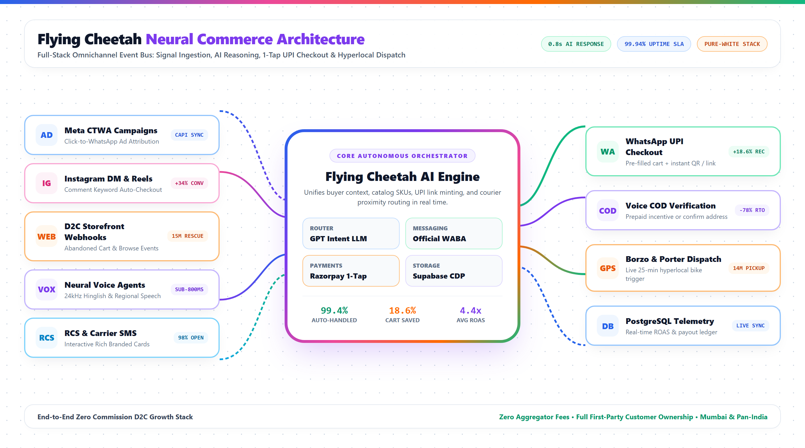
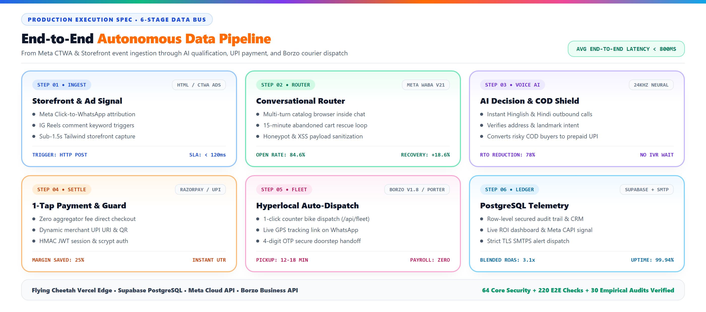
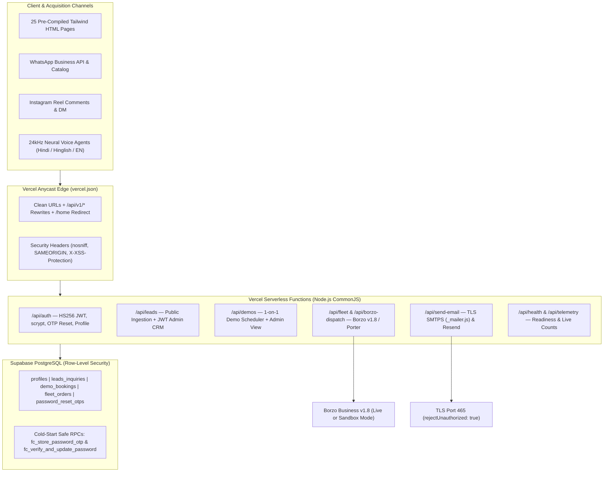

# System Architecture Specification

Flying Cheetah Labs is architected as an **event-driven, serverless-first AI commerce and hyperlocal fulfillment platform** for direct-to-consumer (D2C) retail brands. It unifies `25` pre-compiled responsive HTML pages (`flying-cheetah/*.html`), Vercel Serverless Node.js APIs (`flying-cheetah/api/*.js`), Supabase PostgreSQL persistence with cold-start resilient RPCs, and courier dispatch integration (`Borzo Business API v1.8` & `Porter`).

---

## High-Level Architecture Visuals

<div align="center">
  
  <br /><sub><strong>Neural Commerce Event Bus</strong> — multi-channel signal ingestion, conversational AI router, 1-tap UPI settlement, and courier dispatch.</sub>
</div>

<br />

<div align="center">
  
  <br /><sub><strong>6-Stage Execution Pipeline</strong> — ad click &amp; chat qualification through COD voice shielding, UPI capture, and PostgreSQL telemetry.</sub>
</div>

---

## Production Topology (`flying-cheetah/` on Vercel + Supabase)



---

## End-to-End Conversion & Fulfillment Sequence

```mermaid
sequenceDiagram
    participant Shopper
    participant Storefront as Storefront / Meta CTWA
    participant WA as WhatsApp Cloud &amp; Bot
    participant Voice as AI Voice COD Shield
    participant API as Vercel Serverless APIs
    participant DB as Supabase PostgreSQL
    participant Fleet as Borzo 2-Wheeler API

    Shopper->>Storefront: Taps ad or browses product catalog
    Storefront->>API: POST /api/leads or checkout event
    API->>DB: Persist validated record (502 on DB failure)
    Storefront-->>WA: Opens 15-min cart recovery or 1-tap UPI link
    alt Unverified Cash-on-Delivery Order
        WA->>Voice: Triggers outbound Hinglish/English verification call
        Voice->>Shopper: Confirms address &amp; offers prepaid UPI switch
    end
    Shopper->>Fleet: Confirms payment / verified COD
    API->>Fleet: POST /api/borzo-dispatch (action: create)
    Fleet-->>Shopper: WhatsApp GPS live tracking link + 4-digit delivery OTP
```

---

## Key Architectural Design Decisions

1. **Zero Runtime CSS/Framework Bloat:** All stylesheets compile at build time via `npm run build` (`tailwindcss -i ./css/input.css -o ./css/styles.min.css --minify`) with zero `cdn.tailwindcss.com` dependency in production HTML.
2. **Serverless Cold-Start OTP Continuity:** Password reset and password change OTPs are persisted simultaneously in memory (`ACTIVE_OTPS`) and via Supabase RPCs (`fc_store_password_otp` / `fc_verify_and_update_password`), allowing multi-instance Vercel serverless invocations to verify codes reliably.
3. **Fail-Closed Error Semantics:** Public lead and demo creation endpoints (`/api/leads`, `/api/demos`) return `HTTP 502` on upstream database failures rather than masking outages with synthetic `201` payloads, while protected admin `GET`/`PATCH` routes reject unauthenticated requests with `HTTP 401`.
4. **Optional FastAPI Experimental Service (`backend/`):** The root `backend/` folder preserves a containerized FastAPI + Celery + Redis experimental worker stack for local async experiments alongside the Vercel Node production core.
