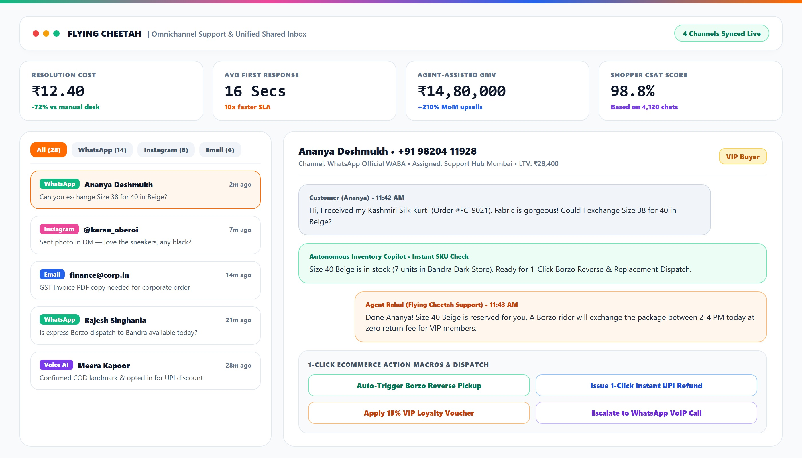
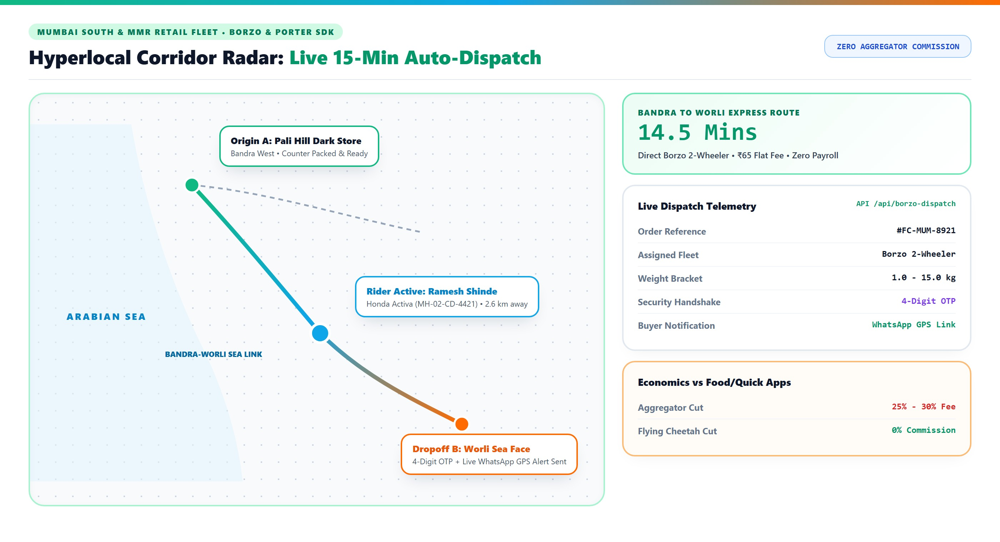

# Modules & Storefront Suite Catalog

Flying Cheetah Labs spans `25` dedicated HTML pages engineered for D2C commerce automation, omnichannel engagement, hyperlocal dispatch, and internal lead operations.

---

## Visual Product Workbenches

  <table>
    <tr>
      <td width="50%" align="center">
        
         <strong>Unified Shared Inbox Desk</strong> — 1-click Borzo reverse pickup &amp; instant UPI refund macros.
      </td>
      <td width="50%" align="center">
        
         <strong>Mumbai South &amp; MMR Fleet Corridor</strong> — automated 12–18 minute bike assignment with 0% aggregator cut.
      </td>
    </tr>
  </table>

---

## Complete 25-Page Platform Map

### Acquisition & Storefront Engineering
| Page | Role & Highlights |
| :--- | :--- |
| [`index.html`](../flying-cheetah/index.html) | Flagship landing hub: live hover revenue telemetry SVG (`3.1x` ROAS), 5-card product ecosystem, `#data-visualization` benchmark suite, and interactive `#roi-estimator` calculator |
| [`web-development.html`](../flying-cheetah/web-development.html) | High-speed D2C storefront engineering (`Starter ₹14,999`, `Hyperlocal Autonomous Hub ₹29,999`, `Omnichannel Enterprise ₹59,999+`) & freelancer/agency comparison matrix |
| [`store-automation.html`](../flying-cheetah/store-automation.html) | Website activity behavioral triggers (browse abandonment, cart save, post-purchase flows) targeting `+24%` shopper recovery |
| [`solutions.html`](../flying-cheetah/solutions.html) | Deep-link interactive module architecture viewer (`?module=whatsapp-chatbot`, `?module=instagram-chatbot`, `?module=ai-commerce-agents`, etc.) |

### Conversational Commerce & Voice AI
| Page | Role & Highlights |
| :--- | :--- |
| [`whatsapp-automation.html`](../flying-cheetah/whatsapp-automation.html) | 15-minute abandoned cart rescue journeys, interactive monthly ROI recovery slider, and animated pipeline player |
| [`whatsapp-marketing.html`](../flying-cheetah/whatsapp-marketing.html) | Segmented WhatsApp broadcast studio with dynamic catalog drops & in-chat UPI links |
| [`whatsapp-calling.html`](../flying-cheetah/whatsapp-calling.html) | Native WhatsApp VoIP business calling workflows for instant concierge closures |
| [`instagram-automation.html`](../flying-cheetah/instagram-automation.html) | Reel comment keyword & Story mention auto-DM funnels connected to WhatsApp checkout |
| [`ctwa-automation.html`](../flying-cheetah/ctwa-automation.html) | Meta Click-to-WhatsApp Ad funnels with Conversion API (CAPI) purchase loop attribution |
| [`ai-voice-agents.html`](../flying-cheetah/ai-voice-agents.html) | Interactive 24kHz Hinglish, Hindi & Indian English voice demonstrator (`cod`, `vip`, `delivery` playback samples + live acoustic orb call simulator) |

### Messaging Channels, Data & Support
| Page | Role & Highlights |
| :--- | :--- |
| [`rcs-messaging.html`](../flying-cheetah/rcs-messaging.html) | Verified Google RCS Android rich carousels and action CTA buttons |
| [`sms-marketing.html`](../flying-cheetah/sms-marketing.html) | TRAI DLT-compliant sub-5s failover SMS alerts on Jio, Airtel & Vi |
| [`email-marketing.html`](../flying-cheetah/email-marketing.html) | Automated retention sequences synchronized with storefront order state |
| [`customer-support.html`](../flying-cheetah/customer-support.html) | Multi-channel shared inbox unifier (WhatsApp, Instagram, Email, Live Chat) with 1-click logistics macros |
| [`customer-data-platform.html`](../flying-cheetah/customer-data-platform.html) | 360-degree first-party shopper identity resolution linking ad source, chat intent, and order LTV |

### Live Logistics, Store Demo & Portal Utilities
| Page | Role & Highlights |
| :--- | :--- |
| [`delivery.html`](../flying-cheetah/delivery.html) | Turnkey seller auto-dispatch workflow & interactive `#dispatchSandbox` connected to `/api/borzo-dispatch` |
| [`store.html`](../flying-cheetah/store.html) | Full interactive ecommerce storefront sandbox with category filters, 1-click UPI QR modal, COD simulation, & live Supabase order dispatch banner |
| [`demo.html`](../flying-cheetah/demo.html) | 1-on-1 architecture walkthrough scheduler wired directly into `/api/demos` |
| [`admin.html`](../flying-cheetah/admin.html) | JWT-authenticated internal CRM console for lead triage (`GET`/`PATCH /api/leads`) and CSV export |
| [`about.html`](../flying-cheetah/about.html) | Founders story ([Bhagat Mukhiya](https://www.linkedin.com/in/bhagat-mukhiya-b74683380) & [Yash Gaikwad](https://www.linkedin.com/in/yash-gaikwad-1669b0397)), engineering manifesto, & Mumbai agency contacts |
| [`home.html`](../flying-cheetah/home.html) & `404.html` | Executive portal index (`/home` 301 redirects to `/` in production) & branded 404 route recovery hub |

---

## Economics: Manual Stack vs. Flying Cheetah

| Metric | Legacy Manual Setup / Quick Apps | Flying Cheetah Autonomous Stack |
| :--- | :--- | :--- |
| **Marketplace / Platform Commission** | `25% – 30%` retained per order | `0%` commission — direct UPI & brand ownership |
| **Inquiry First Response Speed** | `4 – 12 hours` (manual queue) | `< 0.8s` AI bot & `< 15s` instant handoff |
| **Abandoned Cart Recovery** | `4.2% – 8.5%` static emails | `18.6%` 15-minute WhatsApp + UPI rescue |
| **Cash-on-Delivery RTO Rate** | `~34%` unverified returns | `~7.4%` (`-78%` via AI Voice COD shield) |
| **Hyperlocal Counter Pickup SLA** | `150+ mins` manual booking | `12 – 18 mins` Borzo 2-wheeler API auto-dispatch |
